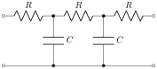
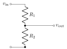
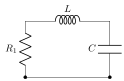
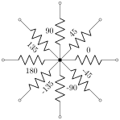
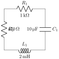
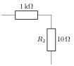

<p align="center"></p>

# voltik

voltik converts CircuiTikZ circuits to SVG and PNG, with no TeX installation, no fonts on the system and no external processes. It is a library of [tikra](https://github.com/matheusmota-dev-br/tikra): tikra draws the TikZ, voltik adds the CircuiTikZ keys and components on top of it, and labels are set by [mathra](https://github.com/matheusmota-dev-br/mathra) in Latin Modern, TeX's own Computer Modern. **[Try it in the browser](https://matheusmota-dev-br.github.io/voltik/)** · **[See the gallery](https://matheusmota-dev-br.github.io/voltik/gallery.html)**.

## Install and use

| Where | Install | Registry |
|---|---|---|
| JavaScript and TypeScript: Node, bundlers, browsers | `npm install @mathlabs/voltik` | [npm](https://www.npmjs.com/package/@mathlabs/voltik) |
| Python 3.9+: wheels for Linux, macOS and Windows | `pip install voltik` | [PyPI](https://pypi.org/project/voltik/) |
| Terminal | `cargo install voltik-cli` | [crates.io](https://crates.io/crates/voltik-cli) |
| Rust | `cargo add voltik` | [crates.io](https://crates.io/crates/voltik) · [docs.rs](https://docs.rs/voltik) |

### JavaScript and TypeScript

Types included. In Node it works right away; in browsers and bundlers, await `init()` once. More in [`npm/README.md`](https://github.com/matheusmota-dev-br/voltik/blob/main/npm/README.md).

```js
import { init, circuitikzToSvg, render, png } from "@mathlabs/voltik";

await init();                                                    // browsers and bundlers; Node needs nothing
const svg = circuitikzToSvg(String.raw`\begin{circuitikz}\draw (0,0) to[R=$R_1$, o-*] (2,0);\end{circuitikz}`);
const { warnings, alt, description } = render(code);             // what was ignored, and the figure in words
const bytes = png(svg, { dpi: 300 });                            // Uint8Array; { background: false } for transparent
```

### Python

```python
import voltik

svg = voltik.circuitikz_to_svg(r"\begin{circuitikz}\draw (0,0) to[R=$R_1$, o-*] (2,0);\end{circuitikz}")
open("r.png", "wb").write(voltik.png(svg, dpi=300))     # background=False for transparent
voltik.render(code)["warnings"]                          # dict: svg, alt, description, warnings
```

Types included; more in [`crates/python/README.md`](https://github.com/matheusmota-dev-br/voltik/blob/main/crates/python/README.md).

### Terminal

```console
$ voltik circuit.tex -o circuit.svg
$ voltik circuit.tex -o circuit.png --dpi 300       # white background
$ voltik circuit.tex -o circuit.png --transparent
$ cat circuit.tex | voltik --warnings               # warnings listed
$ voltik circuit.tex --describe                     # the figure in words: alt text and description
```

### Rust

```rust
let out = voltik::convert(r"\begin{circuitikz}\draw (0,0) to[R=$R_1$, o-*] (2,0);\end{circuitikz}")?;
std::fs::write("r.svg", &out.svg)?;
std::fs::write("r.png", voltik::png(&out.svg, 300.0, true)?)?;
for w in &out.warnings { eprintln!("{w}"); }
```

`voltik::LIBRARY` is a library of [`tikra::extension`](https://docs.rs/tikra/latest/tikra/extension/): it can also be given to `tikra::convert_with_libraries` next to other libraries.

The banner above is drawn by voltik itself from [`docs/banner.tex`](https://github.com/matheusmota-dev-br/voltik/blob/main/docs/banner.tex).

## Examples

Every image is an SVG written by voltik from a circuit of [`corpus/`](https://github.com/matheusmota-dev-br/voltik/tree/main/corpus); the [gallery](https://matheusmota-dev-br.github.io/voltik/gallery.html) has them all, and opens each in the playground.

<table>
<tr><td align="center"><a href="corpus/circuits/ladder-network.tex"></a><br><sub>An RC ladder network</sub></td><td align="center"><a href="corpus/circuits/voltage-divider.tex"></a><br><sub>A voltage divider</sub></td></tr>
<tr><td align="center"><a href="corpus/circuits/rlc-circuit.tex"></a><br><sub>An RLC circuit</sub></td><td align="center"><a href="corpus/labels/labels-around.tex"></a><br><sub>Labels at every angle, smart alignment</sub></td></tr>
<tr><td align="center"><a href="corpus/labels/units-and-annotations.tex"></a><br><sub>Labels and annotations with units</sub></td><td align="center"><a href="corpus/styles/european-styles.tex"></a><br><sub>European resistors</sub></td></tr>
</table>

## How close to CircuiTikZ

The specification is the [CircuiTikZ manual](https://ctan.org/pkg/circuitikz) (version 1.8.7). Each circuit is also drawn by CircuiTikZ itself in TeX Live, and the two drawings are compared: the shapes by their coordinates, the labels by where their ink falls. TeX is only the reference to compare with; the behavior comes from the manual.

```console
$ tools/oracle/tex.sh corpus/*/*.tex                                 # TeX's drawings, in tools/oracle/out (Docker)
$ for f in corpus/*/*.tex; do voltik $f -o ${f%.tex}.voltik.png --dpi 200; done
$ python3 -I tools/oracle/side.py side.png corpus/*/*.tex              # side by side, for a look
$ python3 -I tools/oracle/ink.py corpus/labels/*.tex                   # labels in red: their offset from TeX, in pt
```

The shapes of the components drawn so far match TeX's coordinates; labels on lines at 0°, 90°, 180°, 270° and rotated labels fall within about half a point of TeX's.

## Input

A `circuitikz` environment, or a `tikzpicture` that uses CircuiTikZ components, alone or in a full `standalone` document. Everything tikra reads is read too, so TikZ and CircuiTikZ mix in the same figure.

## What it draws

- **Path-style components**, `to[name=label, options]`: `short`, `open`, `generic`, resistors (`R`, `resistor`, `american resistor`, `european resistor`), capacitors (`C`, `capacitor`) and inductors (`L`, `inductor`, `cute inductor`).
- **Labels and annotations**: `l`, `l^`, `l_`, `a`, `a^`, `a_`, and `R=label` for `l`; straight, rotated and smart alignment (`label/align`, `smart labels`…); `label distance`, `annotation distance`; the siunitx shorthand `20<\ohm>`.
- **Poles**: `o-*`, `*-o`, `-o` and the other combinations of none, `o` and `*`.
- **Orientation**: `mirror`, `invert`.
- **Settings and styles**: `\ctikzset`, `\ctikzvalof`; `bipoles/length`, `bipoles/thickness`, the class keys `resistors/…`, `capacitors/…`, `inductors/…` (`scale`, `width`, `thickness`, `zigs`, `coils`); `american`, `european`, `american resistors`, `european resistors`, `cute inductors`.

What is drawn and what is not yet is in [`spec/subset.md`](spec/subset.md).

## Warnings, not errors

What voltik does not draw yet becomes a **warning**, and the rest of the circuit is drawn: a component it does not know (a source, a diode), an option it does not read. `--warnings` lists them; `Output::warnings` has them in the library.

## Development

```console
$ cargo test                                  # every test
$ cargo clippy --all-targets -- -D warnings
$ npm/build.sh && npm/test/run.sh             # the npm package, packed and installed as users get it
$ site/build.sh                               # the playground: then open site/index.html
$ scripts/release.sh --dry-run                # what a release would publish
$ python3 -I scripts/examples.py              # the README's examples, after cargo build --release -p voltik-cli
$ VOLTIK_UPDATE_BANNER=1 cargo test -p voltik --test banner   # after a change that redraws the banner
```

voltik depends on the published `tikra` crate. To work against a local checkout of tikra next to this one, add to `.cargo/config.toml` (ignored by git), and leave the `Cargo.lock` changes it causes out of commits:

```toml
[patch.crates-io]
tikra = { path = "../tikra/crates/core" }
```

**Releasing.** Each package has its own version: `Cargo.toml` (crates `voltik` and `voltik-cli`), `npm/package.json` and `crates/python/Cargo.toml`. Bump the ones to release in a pull request, and turn `## Unreleased` of [CHANGELOG.md](CHANGELOG.md) into `## <version> - <date>`, with what changed and the corpus figures that show it; add a line to `docs/progress.tsv` (date, components drawn, corpus figures). Merge it, then run `scripts/release.sh` on main: it tags what is not published yet, the tags start `crates.yml`, `npm.yml` and `pypi.yml`, and the script makes the GitHub release from the changelog.

The first release needs a few steps by hand, because crates.io and npm only let a package that already exists trust a workflow:

1. crates.io: `cargo login`, then `cargo publish -p voltik` and `cargo publish -p voltik-cli`. Then, for each crate, Settings → Trusted Publishing: repository `matheusmota-dev-br/voltik`, workflow `crates.yml`.
2. npm: `npm/build.sh && cd npm/pkg && npm publish --access public` (the `@mathlabs` scope). Then in the package settings, Trusted Publisher → GitHub Actions: repository `matheusmota-dev-br/voltik`, workflow `npm.yml`.
3. PyPI accepts a trusted publisher before the project exists: Publishing → add a pending publisher, project `voltik`, repository `matheusmota-dev-br/voltik`, workflow `pypi.yml`, environment `pypi`. The `py-v*` tag publishes it.
4. GitHub: Settings → Pages → Source: "GitHub Actions", for the playground (`pages.yml`), and an environment named `pypi`.

Every pull request runs the same checks (`.github/workflows/ci.yml`): fmt, clippy, the Rust, wasm, npm and Python tests.

## Credits

voltik reads the language of [CircuiTikZ](https://github.com/circuitikz/circuitikz), by Massimo A. Redaelli, Stefan Lindner, Stefan Erhardt, Romano Giannetti and its contributors, and its figures are checked against the ones TeX draws with it. CircuiTikZ remains the reference; voltik is an independent project, not affiliated with it.

## Licenses

Code: MIT or Apache-2.0. Labels are set in Latin Modern Math, the OpenType version of TeX's Computer Modern (GUST Font License), which comes from mathra with its STIX Two Math (SIL OFL 1.1); the Python and npm packages carry both license texts.
